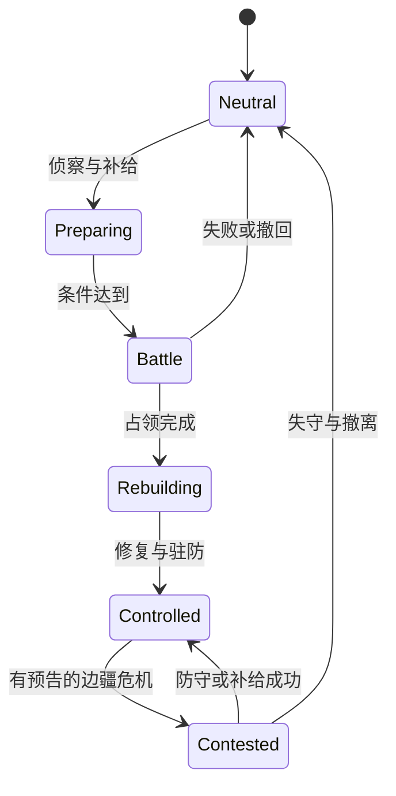
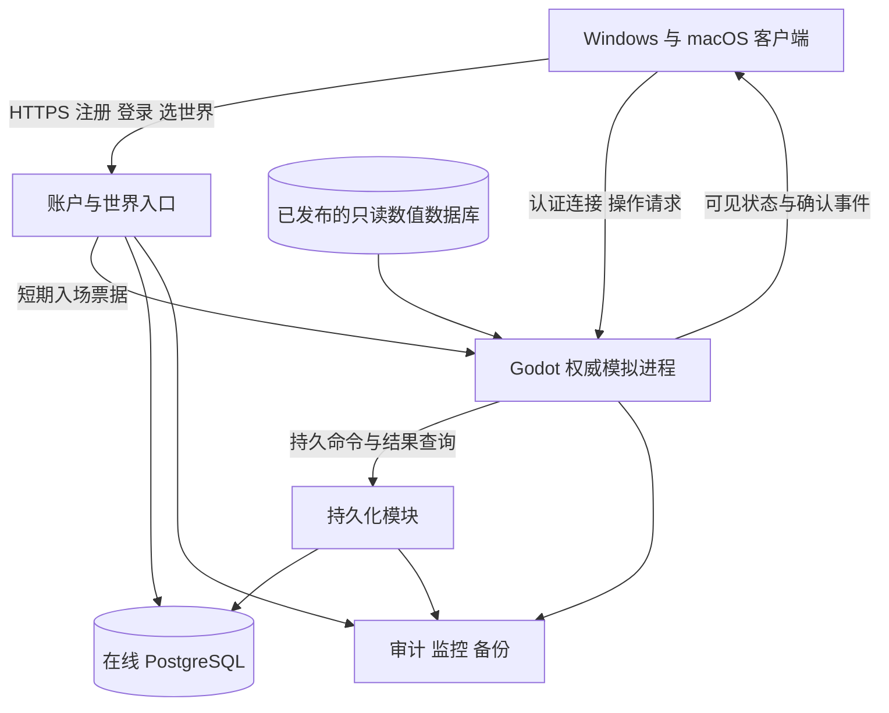

# 星际战舰下一阶段玩法与在线化路线图

日期：2026-10-11。现状基线：v0.16.0，仓库提交 `05a3a9e`；对应游戏内容与交付见[文明声望与星域战争](49-文明声望与星域战争.md)和[交付记录](26-开发阶段与交付记录.md)。

**建议先把现有星域做成值得反复出航的世界，再以同一套规则支持小规模合作和持久在线世界。** 下一阶段的重点是让探索发现、舰船配装、资源需求和文明战争相互影响。在线化先证明两名玩家能可靠地共同航行、交战和结算，再开放账号与持续进度，最后根据真实人数扩大承载能力。

本文是供项目负责人安排后续开发的完整建议。已有功能、用户已确认边界、下一阶段提案分别标明；阶段编号用于规划，不代表版本承诺或已实现功能。本次交付只增加计划文档，不改动游戏、存档和部署。

阅读入口：[当前缺口](#2-当前基础和主要缺口) · [玩法深化](#4-优先完善的玩法) · [首个内容包](#5-第一份可玩内容包) · [在线规则](#7-在线化的产品规则) · [技术改造](#8-推荐技术架构) · [阶段与人力](#12-分阶段执行路线) · [成本](#13-成本与容量预算) · [待确认决策](#14-实施前需要确认的决策)。

## 1 方向与边界

### 1.1 已确认且继续遵守的要求

- 保留探索、采矿、战斗、配装、工业和多星系航行的主体体验；现有离线单人版继续可用。
- 战略地点之间采用真实 AU 尺度，局部操舰、停靠和战斗保留 m/km；扩大内容不重新把星系压缩为一个小场景。
- 三文明有不同领地、舰船与科技特色；出生星系及周围受保护中立航路保持中立。
- 单一效忠、允许改换；分别保留各文明声望、已有舰船和已获知识，效忠决定专属采购、制造和战争权限。
- 旧离线世界升级先备份，再创建新版规则分支，旧手动档和已有资产继续保留。
- 数值与持久状态由数据库管理；正式资源、设计文档和测试脚本继续遵守工作区目录边界。

原[启动草案](01-项目启动草案.md)确认的使用范围是自己和朋友。此次提出“注册账号密码、成为在线游戏”，明确需要规划在线能力，但没有同时确定公开运营、商业收费或万人同服。因此先按朋友之间可长期游玩的在线世界规划；公开运营单列为后续决策。

### 1.2 建议的产品定位

**以舰船分工和文明边疆为核心、可单人也可小队合作的太空沙盒。** 玩家应能回答三个问题：这次为什么出航，这套配装准备应对什么，带回的成果会改变什么。

近期把开发资源集中在三项结果：

1. 相同出航目标能够产生不同的路线、装备和撤退选择。
2. 探索者、矿工、运输者、战斗与支援舰都有不可完全替代的贡献。
3. 个人成长和星域变化互相连接；完成任务之后，下一次出航的条件有所变化。

暂缓行星表面登陆、无缝万人同服、上百种新舰、全自由空间站搭建、现实时间长期技能等待和全面开放 PvP。它们的制作与维护成本高，且不能直接修复现阶段循环重复的问题。

### 1.3 建议采用的在线规模

| 阶段 | 玩家看见的产品 | 规划目标 | 启动条件 |
| --- | --- | --- | --- |
| 合作样例 | 同一任务空间共同出航 | 先 2 人，再验证 4 人 | 完成服务器权威拆分 |
| 朋友在线版 | 账号登录，离线后资产仍在，世界由专用进程保存 | 首轮 4–8 人同服，一个队伍最多 4 人 | 结算、重连和恢复演练通过 |
| 小型持久星域 | 多支队伍在不同地点活动，共享区域变化 | 验证 16–32 人同服，热点单独设上限 | 兴趣区同步与运行指标达标 |
| 扩容阶段 | 更多玩家与世界分区 | 按负载实测决定 | 已有持续使用者，容量确有瓶颈 |

以上人数是设计和压测目标，不是当前引擎、客户端或服务器已达到的能力。“同服总人数”“同一战场人数”“同时可见实体数”须分别统计；增加注册账号数不代表增加同场战斗容量。

## 2 当前基础和主要缺口

### 2.1 当前实际具备的内容

| 领域 | 当前基础 | 对下一阶段的意义 |
| --- | --- | --- |
| 星域 | 54 星系；三文明各 12 个领地；18 个中立星系，其中原 10 个受保护、8 个边疆可争夺 | 地图规模已经足够开展首轮差异化内容，不急于再翻倍 |
| 舰船与装备 | 18 型舰船，包括 9 型文明专属舰；39 个模块，其中 18 个攻击模块，含无人机与武器梯队 | 先验证各舰和各配装的用途，再决定补什么舰 |
| 成长 | 教学、主线、合同、入籍、巡护，共 52 项任务定义；13 项研究；八级爵位 | 数量不能直接等同于独立玩法数量或自然成长时长 |
| 战争 | 24 个委托覆盖 8 个边疆目标；单次 3 艘友舰、4 艘守军及当地敌人；战斗和持续占领后改变主权 | 已有实际舰队交战基础，适合扩展目标和战后状态 |
| 经济 | NPC 库存、收购预算、声望折扣、材料制造、拆解、修理与个人设施 | 有来源与消耗约束，可逐步建立区域需求 |
| 航行与表现 | AU 战略地点、局部空间、跃迁、类别武器表现、受击、恒星照明和图标菜单 | 后续应服务于战术信息，不重复堆纯装饰效果 |
| 数据 | 冻结内容版本、完整关系快照、存档分支、会话隔离、升级备份 | 可复用身份、版本和验证思想，在线持久化仍需另行设计 |

文明专属舰当前采用既有工业船体平台加文明结构和涂装，不应把九种变体写成九种全新船体平台。战役友军目前在目标空间生成，不是跨多个星系持续行军的战略舰队。当前也没有账号服务、真实多人传输层或玩家交易市场。

### 2.2 从代码结构能确认的限制

- [state.gd](../code/runtime/state.gd) 的 `player()` 默认取玩家列表第一项；`ship()` 和当前星区由该玩家推导。多人不能只增加第二个模型，必须显式区分每位玩家、每艘舰和各自可见状态。
- [main.gd](../code/runtime/main.gd) 同时组织输入、物理、射击命中、界面、暂停与保存。在线客户端不能继续决定最终伤害或暂停整个世界。
- [gameplay.gd](../code/runtime/gameplay.gd) 已有命令与结果 DTO，但动作 ID、操作者和会话由本机创建，成功先应用到内存，再申请自动保存。它是离线业务边界，不是已具备鉴权和耐久回执的网络服务。
- [economy.gd](../code/runtime/gameplay/economy.gd) 目前以预设买卖价、声望调整和库存周期为基础；制造直接发放产物。存在库存与生产记录，不等于已实现供需经济、制造队列或订单撮合。
- [civilizations.gd](../code/runtime/gameplay/civilizations.gd) 处理入籍、捐献、舰船权限和单次战役；目前没有自动外交、补给线和持续争夺循环。

既有大批自动断言证明了许多功能与异常边界，但没有证明自然游玩数十小时仍有变化，也没有测量多人承载。下一阶段要增加真实试玩和行为观察，而不以测试数量替代乐趣判断。

### 2.3 需要优先验证的体验假设

| 假设 | 对玩家的潜在影响 | 如何验证 |
| --- | --- | --- |
| 多个星系的主要行为过于接近 | 换了名字和场景，出航决策仍相同 | 比较三类星系中玩家实际路线、配装和撤退原因 |
| 成长过度依赖重复捐献和同型合同 | 高级爵位变成材料计数器 | 记录自然到达各里程碑的时间及声望来源比例 |
| 强舰和高阶武器可能覆盖太多场景 | 收集与尝试的价值下降 | 同预算比较不同任务中的完成率、损耗和操作负担 |
| 占领之后缺少新的职责 | 八个目标打完后缺少战争目标 | 让试玩者完成占领，观察是否能主动提出下一步 |
| 自动接敌与开火减少了决策 | 战斗变成等待血条归零 | 比较有敌方意图、支援角色和撤离条件的遭遇 |

这些是根据现有实现提出的设计判断，仍须试玩验证。自动战斗应保留为减轻重复操作的工具；玩家决策转向目标优先级、站位、设备时机和风险管理。

## 3 让一次出航产生下一次目标

### 3.1 三层循环

| 时间层 | 玩家要作出的选择 | 带回的结果 | 下一次目标 |
| --- | --- | --- | --- |
| 一次遭遇，约 3–8 分钟 | 扫描哪条信号、先压制哪艘敌舰、是否多挖一轮 | 情报、局部资源、受损与暴露程度 | 深入、转向或撤退 |
| 一次出航，约 15–30 分钟 | 舰型、模块、路线、仓位和风险预算 | 材料、研究线索、合同成果 | 改装、交付需求或继续调查 |
| 一个阶段，数次出航 | 专精哪种工作、支持哪个文明、建设哪个据点 | 新战术选择、设施能力与地区变化 | 新任务链与合作目标 |

时间是首轮内容节奏假设，不是强制时长。短时间玩家应能完成有结果的出航；长时间玩家可自选连续行动。保留随时返航与稳定地点退出，避免把运输等待或重复采矿当作主要内容。

### 3.2 一次完整出航的样例

玩家在边疆站看见结构材料短缺，扫描情报同时提示附近出现失联运输信号。选择先带扫描模块调查，会少装一个战斗辅助模块，但可能找到安全物流捷径。

到达后发现受损运输舰。可以先修复并护送，获得稳定报酬和文明贡献；也可以先回收附近残骸，获取研究样本，但延迟会让敌方截击队接近。若带上朋友，一人维修、一人警戒、一人运输，可以完成更多目标；单人则通过顺序操作和撤退完成其中一条路径。

运输成功后，该站下一阶段获得有限工业折扣和补货，后续会出现重建合同。失败不会锁死进度，而是使区域出现清障或救援任务。收益、代价、世界后果都能在界面上解释。

这个样例必须实现为可玩的连续流程，再决定是否扩大到全域。首版只选择少量地点，避免把同一模板机械复制到 54 个星系。

## 4 优先完善的玩法

### 4.1 探索从发现按钮升级为判断与选择

保留当前扫描操作，增加“远距线索—局部调查—发现目标—决定处理方式”的层次。情报需要注明更新时间、确定程度、危险迹象与预计设备，扫描后的收获可以是地点、路线、需求或研究证据。

首批建议制作三类有完整结算的探索内容：

| 类型 | 核心选择 | 有价值的收获 | 失败或撤离后的结果 |
| --- | --- | --- | --- |
| 失联舰队 | 救援、护送、回收之间分配时间与仓位 | 声望、航路情报、设施修复材料 | 保留已完成救援，未救目标改变后续合同 |
| 异常遗迹 | 先关闭风险源，或承担风险深入扫描 | 有出处的研究样本、模块专精设计 | 带回部分线索，可寻找替代入口 |
| 临时矿带 | 高品位区域更危险，安全区域产量较低 | 稀缺加工原料和区域资源情报 | 矿带衰减或迁移，不清空玩家已有成果 |

变化由地点拓扑、威胁角色、环境条件和目标顺序组合产生。首批设计约 6 个手工结构、每种 2–3 个经过验证的变体；每个实例在生成时保存版本、种子和阶段，不能读档或重连后重抽奖励。

环境会影响玩法：碎片带影响射界，电磁扰动影响探测或护盾恢复，恒星活动影响暴露时间。所有效果都应有预告、范围和反制，画质降低仍可读懂。不开启每秒扣血却无解释的随机灾害。

新增星系内容按“资源来源、战术环境、物流角色、事件倾向”建立标签。星图显示可理解的差异，并逐区扩展；无须要求每个星系立即拥有独立剧情。

### 4.2 战斗以敌人行为和目标变化形成深度

先扩展已有武器、舰种和无人机的作用，控制新机制数量：

| 战术角色 | 首批行为 | 玩家应对 | 对配装的价值 |
| --- | --- | --- | --- |
| 火力舰 | 蓄能后进行高威胁齐射，有明显预告 | 遮挡、机动、打断或集中防御 | 机动和防护模块有时机价值 |
| 支援舰 | 为同伴维修，自身火力较弱 | 集火支援或分割阵位 | 长程打击和目标切换有意义 |
| 截击舰 | 接近侧后方、施加短时推进干扰 | 小型武器、点防御或脱离队形 | 大舰需要护航，小舰有用途 |
| 载机舰 | 分批投放无人机、回收和补充 | 压制母舰或击毁无人机 | 防空与无人机管理形成取舍 |

首个版本只加入支援舰和一种可反制的干扰，不同时上线完整电子战体系。干扰需要持续时间上限、重复作用衰减和最低操控保障，不能让玩家长时间失去控制。

任务胜利条件从“全部击毁”扩展为保护目标、拆除干扰源、抢救货物、护送脱离和限时突破。撤退完成部分目标时给予对应成果，不把所有任务压成全胜或零收益。

无人机增加攻击、跟随、回收的明确状态；通信范围、出击数量、补充来源和丢失成本入库。先验证回收与目标切换，再考虑维修或侦察无人机。远距 AI 可以降低更新频率，实际造成伤害的无人机必须受权威判定。

配装页提供射程、持续输出、爆发输出、电容与热量、机动和货舱的对比，区分“理论值”和“特定目标条件下估计值”。导弹、炮弹、激光和无人机的反制通过命中、飞行时间、射界、射程与资源消耗体现，不只更换特效颜色。

### 4.3 舰船成长保留选择而非只增加倍率

现有 I/II/III 武器梯队继续存在，高阶装备提供价值，同时占用更高成本、能源、热量或装配预算。后续优先做少量专精分支，例如短时爆发、稳定持续、远程压制；同一总预算下至少有不同任务的适用理由。

三文明的成长方向继续保持：航路议会偏护盾、能量与无人机协同；深铸联合体偏装甲、动能与阵地突破；游弋同盟偏机动、导弹与远程控制。每个优势都配置可见代价，公共舰继续具备低维护、宽泛装配或通行便利的价值。

先用现有 18 艘舰完成角色矩阵，再决定补充专用后勤舰、侦察舰或运输舰。判断标准是是否出现现有舰无法合理承担的任务，不是舰船总数是否够大。

长期奖励优先开放战术、情报、设施、指挥资格和外观。新增科研样本设替代取得途径或可积累的研究进度，避免极低概率掉落成为唯一前置。随机词条和无限强化暂缓，以免平衡与装备理解成本失控。

### 4.4 采矿与工业形成真实用途

采矿的核心选择是“去哪、采什么、带多少、谁来保护、送到哪里”。低风险基础矿长期可得，高风险矿提供效率或专精材料；基础推进、返航和最低保障不依赖某个被封锁的唯一矿点。

建议先改三个环节：

1. **矿点情报**：显示品位、预计余量、风险与装满货舱的估算；实际采集仍以权威余量结算。
2. **站点需求**：需求由可解释的消耗和事件触发，设置量、期限、价格上下限及交付地点；玩家看见为什么这里需要材料。
3. **工业选择**：先维持短配方链，显示缺料来源、总成本和成品用途；再增加有上限的制造队列，排队不成为登录打卡任务。

初期采用有边界的 NPC 供需模型：库存变化与事件调整报价，刷新有限预算；价格与成交时刻的报价版本绑定。经济波动从少数物资、少数站点开始，先排查循环套利和供应中断，再扩大范围。

供应链建议控制在“原矿—关键材料—模块或设施”两到三层。运输收益扣除采购、维修、能源或弹药、通行、损耗后仍应可理解；航程本身的等待不是收益的唯一依据。

| 来源 | 对应消耗或约束 | 要监测的问题 |
| --- | --- | --- |
| 任务与 NPC 收购产生信用点 | 修理、工业服务、通行、研究、有限设施维护 | 资产增长是否远超可消费目标 |
| 采矿产生材料 | 制造、维修、战区补给、设施升级 | 单一矿种是否同时成为所有玩法的瓶颈 |
| 战斗与遗迹产生样本和残骸 | 科研、鉴定、专精制造 | 是否存在无风险无限刷取或重复领奖 |
| 舰船与模块制造 | 战损、维护、交易需求 | 若很少损失且很快全收集，工业还有什么用途 |

费用和损耗必须服务于选择，避免为了维持经济强加高额日租或离线惩罚。玩家市场推迟到物品追溯、托管交易和反重复结算已经稳定之后；朋友在线版先提供双方确认的站内交易。

### 4.5 文明发展与战争形成后续目标

保留已确认的入籍、声望与效忠规则。新增荣誉任务与贡献记录作为新指挥权限的条件，让矿物供应、救援、侦察和战斗都能贡献；不追溯撤销旧离线玩家已获得的爵位或舰船。

捐献仍是成长途径，但高级指挥资格建议要求一组不同类型的能力任务，避免只购买矿物即可完成全部后期内容。新权限的条件和声望增速先自然试玩，再写入新版定义。

边疆战争逐步形成以下状态：

图中状态仅适用于新增的可争夺边疆规则：`Neutral` 中立、`Preparing` 准备、`Battle` 作战、`Rebuilding` 重建、`Controlled` 受控、`Contested` 争夺。原受保护十星系不进入循环，文明初始核心领土首轮不开放攻占。

首批战争增加“侦察准备、护送补给、两种战斗目标、占后修复”即可。真实跨门行军属于后续增强项；在实现前，应把现有援军表述为在目标集结。

占领收益首先体现为航路更安全、部分物资供应、维修与工业条件改善，以及新的合同。控制较多边疆会提高补给压力，使扩张与巩固产生选择；不直接给个人大量永久伤害加成。

避免八个中立目标全部占完后战争永久结束。通过可预告的 NPC 边疆事件和防守任务形成可逆变化，但不自动重置玩家身份、研究和私人舰队。后台战略变化采用粗粒度事件，不在所有无人星系持续模拟每艘舰船。

### 4.6 单人与合作共享内容设计

单人能完成主要进度，合作带来更高效率和更多策略。首轮同一目标按队伍规模调整威胁组合、同时出现的支线和可选奖励，不简单把敌人血量乘人数，也不把关键流程锁死在必须两人同时按按钮。

先提供一个可雇佣 NPC 支援名额，让单人测试后勤或护航配合；指令复用现有推进、集结、集火和撤退，明确费用、损失和补充。更复杂的自有 NPC 舰队、船员职业与忠诚度后置。

在线首批合作功能包括组队邀请、队长移交、共享标记、集合与跃迁准备、队伍目标、装备检查和战后总结。文字沟通配合快捷指令足够启动，语音系统可后置。

共享资产从有额度和权限的队伍补给开始，不立即开放无限制公共仓库。角色分工对应可观测贡献：侦察发现、护航保护、维修支援、货物交付均进入任务结算，不只按最后一击或伤害量奖励。

### 4.7 视觉与声音服务于判断

继续打磨跃迁离场、背景虚化、光照和命中效果，同时为新增玩法补足统一反馈：敌方蓄能、被干扰、无人机失联、友方维修、货物暴露和撤离窗口。

重要状态同时用形状、文字、声音或图标表达，不能只依赖红绿颜色。保留动效强度、模糊、闪光和镜头震动选项；关闭特效不改变碰撞、伤害和可获得情报。

任务界面采用当前步骤与明确地点，提供一键规划航路和缺少设备说明。星图显示需求、战区、所属文明、航路风险与情报时效；菜单命名继续来自共享目录，避免新增功能再次出现两套名称。

### 4.8 长期目标与内容更新

达到高级爵位后，目标应从继续堆声望转向运用已有能力。建议保留四种长期活动：可选择深入程度的深空远征、跨站点的工业建设项目、有准备和战后阶段的边疆战役，以及限定预算的配装挑战。分别适合探索、经营、指挥和研究战术的玩家，单人可以完成基础版本，小队承担更多同时发生的目标。

远征把撤退点与已取得的成果分开：每完成一段即可决定撤回，继续深入获得更稀缺的线索，也承担更高回收成本。工业项目按多批真实交付推进，有可见的阶段效果，允许暂停，不因为错过一天使全部投入归零。配装挑战使用限定舰级或预算检验理解，奖励以称号、涂装、情报和横向专精为主。

新玩家通过保障舰、公共设备、可重复基础任务和朋友协助进入循环；老玩家带队可以获得辅助贡献，但不能代领新人的入籍与关键能力考核。高阶内容不把所有普通材料都挤出用途，公共舰也保留低成本的出航场景。

内容更新采用主题包和可轮换事件，先复用已验证的任务结构，再少量增加新行为。轮换不设必须每天领取的累计奖励，不出售更强战力，也不以永久删除关键研究机会制造登录压力。是否长期商业化另行设计，当前先检验朋友是否愿意自然回到游戏。

## 5 第一份可玩内容包

建议用“边疆重建”作为首个内容包主题，先在 3 个已有星系、6 个地点内验证。它不扩大总星系数，也不要求先写完整个在线后台。

| 项目 | 首轮范围 | 可验收结果 |
| --- | --- | --- |
| 探索 | 失联运输、异常遗迹、临时矿带各一条完整流程 | 同一内容有至少两种合理处理路线，部分成功可结算 |
| 战斗 | 支援敌舰、一种可反制干扰、保护与突破两种目标 | 至少两种配装完成方式，改变优先目标确实影响结果 |
| 工业 | 少量站点材料需求、短配方、明确报价期限 | 采集、运输、制造都能推动同一重建进度 |
| 文明 | 准备、作战、修复三阶段，已有占领能力继续复用 | 战后站点或航路确有变化，重开后仍保留 |
| 成长 | 一项战术专精或设施能力 | 奖励产生下一次出航理由，不靠大幅属性膨胀 |
| 体验 | 情报、配装比较、战后总结 | 玩家能说明收益、损失和下一步目标 |

首轮完成后再制作第二个主题包，例如“航路封锁”或“深空调查”。若第一个内容包反复试玩仍像换地点刷同一批敌人，应回到目标和行为设计，不通过继续加数量解决。

## 6 判断是否变得好玩

### 6.1 自然试玩与技术测试分开

安排至少 5 名体验者，每人两次约 60–90 分钟；至少包含新玩家、熟悉现版的玩家和不同玩法偏好者。样本用于发现问题，不能据此宣布统计意义上的留存提升。

自然试玩不得注入满级爵位、无限资金或直接解锁来证明成长节奏。可另设指定装备的战斗对照实验，结果注明它只验证某种配置。

首轮观察门槛均为项目假设：

| 指标 | 初始目标 | 未达到时的动作 |
| --- | --- | --- |
| 理解当前目标 | 5 人中至少 4 人能在无口头指导下说明下一步及地点 | 改提示与任务结构 |
| 路线与配装差异 | 同一内容至少出现两种可行选择，玩家能说明理由 | 改任务约束和反制关系 |
| 纯等待比例 | 中位出航中，无选择的赶路和等刷新不超过约 20% | 调整地点、自动航行与事件节奏 |
| 失败可解释性 | 5 人中至少 4 人能说出一次失败原因和改进办法 | 增加预告、战报或调整惩罚 |
| 自发续玩意愿 | 多数人能提出具体的下一次目标，并愿意再次体验 | 优先补目标关联，暂缓扩量 |

前 10 分钟应学会观察目标和安全出航；约 30 分钟内体验一次出航、带回成果和有意义改装；首个 90 分钟内见到不同工作方式与文明目标。以上节奏需从全新角色实际测量，不靠提高起始资金掩盖流程问题。

### 6.2 平衡与内容维护

建立同预算配装对照：完成时间、承伤、材料成本、操作强度、撤退成功率和适用目标。不要只比较静态 DPS。需要特别检查母舰无人机、重炮和远程导弹是否使某种任务完全失去风险。

记录信用点与材料的产生、消耗、任务完成时间、弃约原因、死亡原因、航行等待与菜单停留。离线采用本地导出，在线测试先告知采集范围；无需记录聊天全文、密码或无关个人资料。

每个新任务必须说明接取、条件、执行、失败、部分成功或撤退、奖励、后续用途和保存恢复。每个新材料必须有明确来源和用途；每个新模块必须有可见行为和反制；每个新战区必须有结束与重开规则。

## 7 在线化的产品规则

### 7.1 三种世界分开管理

| 模式 | 权威与资产 | 保存和回退 | 信任范围 |
| --- | --- | --- | --- |
| 离线单人 | 本机世界与 SQLite | 继续支持手动档和安全升级分支 | 玩家管理自己的世界 |
| 可选朋友自建房 | 房主或私人专用进程拥有该世界 | 只能整体恢复，参与者统一重连 | 房主可信，不宣称公平公共经济 |
| 账号在线世界 | 指定服务器与服务器数据库 | 玩家不能任意回退；运维按整体恢复流程处理 | 客户端与玩家请求均须验证 |

**推荐先开发账号在线世界的小规模版本。** 可在自己的设备部署专用进程做测试，也可后来部署到服务器；不必额外先做一套会被丢弃的 P2P 房主迁移体系。若最终只需要朋友自建房，可以缩减运营后台，但仍需保留权威结算和多人状态改造。

旧离线存档继续保存。建议在线世界新建角色与资产，不允许上传本机信用点、舰船、声望和修改后的数据库进入共享经济。朋友自建世界若提供旧档导入，应标记为独立非公共世界，不与在线正式世界交换资产。这是在线经济建议，需实施前确认；此次不转换任何个人档。

### 7.2 多人必须先定义的结算规则

| 问题 | 首轮建议 |
| --- | --- |
| 角色与登录 | 一个账号可拥有角色记录；首轮每个世界一个活跃角色、同一角色一个控制会话 |
| 队伍进度 | 共享目标进展，个人前置、入籍和奖励资格分别验证；高等级玩家带队不跳过未完成条件 |
| 收益分配 | 信用点按合格成员规则结算；实物使用服务器分配或队伍约定的固定规则，入场前说明 |
| 贡献判定 | 包括侦察、有效支援和目标交付；设置参与时间与有效行为门槛，减少挂机分奖 |
| 中途加入 | 按实际参与阶段获得奖励，不能加入已结算任务重复领奖 |
| 队长离开 | 已提交目标继续存在；队长移交不改变资产所有权和已锁定的奖励规则 |
| 不同文明组队 | 可共同参加普通 PvE；入籍和专属权益不共享；代表文明的领土战另查参战资格 |
| 争夺同一星系 | 同一领土周期只允许一个权威战役结果；报名、锁定、取消与结算都有持久状态 |
| 个人设施 | 私人权益与世界设施分开；协作建设记录所有者、贡献和使用权限 |
| 交易 | 首轮限同站双方确认，资金与物品托管；队伍邀请不授予仓库权限 |

首轮合作探索可采用队伍实例，避免朋友被其他队伍抢走关键任务目标；站点需求和主权仍属于共享世界。一个实例的产出与资格由服务器登记，不能通过退队或切换队长反复生成同一奖励。共享战区和私人任务实例须在界面清楚区分。

文明专属舰和设计权限还涉及代购与转交。首轮建议只开放普通材料、普通模块的站内交易，暂不交易专属舰、研究许可和任务绑定物；未来开放舰船转交时，单独确认接收方资格。玩家此前合法取得的专属舰仍按已确认规则保留，避免新交易系统无意绕过效忠设计。

### 7.3 时间 暂停与掉线

- 离线继续使用现有世界时间。在线由服务器推进模拟时间，制造和事件期限使用服务器保存的时间，客户端改系统时钟无效。
- 打开菜单只停止本人的输入，不暂停共享世界。安全停靠后可以离开，危险空域有明确战斗状态提示。
- 短暂掉线保留船体并执行预设保守指令；战斗中不能拔网线立即无敌。建议重连宽限从 60–120 秒原型测试起步，具体安全退出延迟独立配置。
- 非战斗掉线完成安全退出后停靠或停泊；战斗掉线仍按规则承受风险。服务器故障与玩家主动断线分开处理，不机械套用惩罚。
- 再次登录恢复服务器已确认状态，期间发生的消耗、死亡或任务结算必须能查到；客户端不得把断线前缓存覆盖回服务器。
- 无玩家在线时，站点库存、有限制造和低频区域事件可以推进；首次测试不开放持续离线袭击私人设施。

### 7.4 PvP 和世界战争的边界

第一份在线版本以合作 PvE 为主。随后可增加双方确认的决斗或独立争夺战区。文明效忠不自动意味着可以攻击所有异文明玩家；中立也不等于默认允许任意杀戮。

若开放 PvP 主权战，需要另行确认宣战窗口、参战人数、盟友资格、补给、资产撤离、离线保护与反复碾压后的恢复机制。先用 NPC 驱动的边疆战争验证，再决定玩家组织是否能代表文明竞争。

战季可以轮换边疆事件和战区奖励，不默认清空角色、已得舰船、研究和声望。有限中立星系通过可逆主权与重建循环继续产生目标，初始区域保护不取消。

## 8 推荐技术架构

### 8.1 复用 Godot 模拟 增加服务边界

推荐以 Godot 无界面专用服务器复用现有运动、碰撞和玩法规则，另设一个模块化后台承载账号、会话、持久化和运维接口。初期一台主机也可以运行多个进程；“模块分离”不要求立即采购多台机器或拆成大量微服务。

Godot 提供无界面运行和专用服务器导出能力；仍须制作独立入口、剥离渲染依赖，并在目标服务器操作系统验证原生扩展和物理行为。现有 Windows 图形客户端通过测试不代表 Linux 服务端已验收。[Godot 专用服务器导出](https://docs.godotengine.org/en/stable/tutorials/export/exporting_for_dedicated_servers.html)

图中账户与持久化模块可在同一后台程序部署，使用不同权限和接口。后台语言在样例阶段按维护经验、Godot 接入和运维能力确定；若没有已有团队惯用栈，可用 Go 做候选。语言选择不改变服务器权威与关系数据库边界。

第一阶段不引入 Kubernetes、全域消息总线、跨区数据库复制或多个互相重叠的游戏后端框架。数据库连接池、进程守护、配置管理、日志和可恢复部署足够支撑原型；是否扩容由测量决定。

### 8.2 现有代码的具体改造点

以下路径为当前入口，新增接口名是设计意图而非已存在实现。

| 当前入口 | 主要改造 | 先行验收 |
| --- | --- | --- |
| [main.gd](../code/runtime/main.gd) | 分离客户端输入/画面与服务器模拟启动，清除服务器对 UI 和相机的依赖 | 无窗口启动世界，并接受两个独立玩家 |
| [state.gd](../code/runtime/state.gd) | 增加按 `player_id` 查询与明确的操作上下文，消除首玩家隐式假设 | 两人各自货舱、舰船、任务和镜头互不串用 |
| [gameplay.gd](../code/runtime/gameplay.gd) 与各业务模块 | 服务端从认证会话解析操作者，白名单命令、权限与幂等检查；客户端改为请求和结果显示 | 修改请求里的他人 ID 不可操作他人资产 |
| [contract_dtos.gd](../code/contracts/contract_dtos.gd) | 网络 DTO 与内部完整快照分开，定义版本、大小上限、序号、错误与重试语义 | 畸形、过期、越界请求被拒绝且无状态变化 |
| [flight.gd](../code/runtime/flight.gd)、[projectiles.gd](../code/runtime/projectiles.gd) | 权威运动、射界、投射物、命中在服务端；客户端只预测和演出 | 两端伤害一致，客户端伪造命中无效 |
| [sector.gd](../code/runtime/sector.gd) | 物理世界与可视工厂解耦，可维护多个活动局部空间 | 玩家在不同地点时互不占用同一全局场景 |
| [local_navigation.gd](../code/runtime/local_navigation.gd)、[travel.gd](../code/runtime/travel.gd) | 每船导航状态、目的地资格、跨地点交接和重连 | 跨门中断后只有一个合法位置和船体 |
| [store.gd](../code/runtime/data/store.gd) | 保留离线实现；引入在线持久化适配器，避免远程照搬全世界手动档 | 交易确认后进程退出不丢账、不重复发奖 |
| [civilizations.gd](../code/runtime/gameplay/civilizations.gd) | 分离个人效忠与共享主权，战役持有者、参与者、领土周期和奖励资格 | 两队同时申请不会产生两个占领结果 |
| [ui.gd](../code/runtime/ui.gd) 与子面板 | 展示网络状态、待确认动作、断线重试和个人视图；去掉在线任意读档入口 | 慢网不重复扣料，拒绝原因可理解 |
| [catalog.gd](../code/runtime/data/catalog.gd) 与 SQL 定义 | 版本固定、摘要握手、服务端校验定义，客户端显示副本 | 修改本机价格和舰船属性不能影响结算 |

当前 `CommandEnvelopeDto` 可提供结构参考，但网络请求必须重新验证。`actor_player_id` 不能由客户端自由声明，Godot 的连接编号也不能充当永久账号 ID。

### 8.3 权威分工

| 内容 | 客户端可做 | 服务器必须决定 |
| --- | --- | --- |
| 操舰 | 收集输入、预测本舰、平滑其他舰 | 合法输入、速度/加速度限制、碰撞、最终位置 |
| 武器 | 立即播放开火反馈，等待确认修正 | 装配、冷却、能源、弹药、射界、命中、伤害 |
| 采矿与扫描 | 进度和范围提示 | 距离、视线、余量、完成时刻、产物 |
| 经济与成长 | 展示报价和提交意图 | 所有权、库存、价格、扣料、任务、声望、科技和奖励 |
| 战争与世界 | 地图和舰队指令界面 | AI、参战资格、占领、主权、刷新与随机结果 |
| 画面与偏好 | 相机、光影、模糊、声音、界面缩放 | 不因客户端特效开关改变规则 |

模拟的瞬时状态仍驻留服务器内存，数据库是数值与持久结果的权威来源；不要求每个物理帧写数据库。客户端本地缓存只能加快显示，不能用于证明资产或完成情况。

### 8.4 传输 同步与时延

账号和低频入口采用 HTTPS；实时战斗以 Godot 的 ENet 路线作为首个技术样例。Godot 提供可靠、有序不可靠等传输模式及独立通道，可以把动作结果与高频位置更新分开。[Godot 高级多人网络](https://docs.godotengine.org/en/stable/tutorials/networking/high_level_multiplayer.html)

ENet 本身不等于完成加密和认证。样例必须验证 Godot 提供的 ENet DTLS 配置、证书校验、两平台兼容和票据绑定；不能把 HTTPS 登录后得到的长期令牌直接明文发到 UDP，也不能在正式环境关闭服务器证书校验。可用接口见 [ENetConnection DTLS](https://docs.godotengine.org/en/stable/classes/class_enetconnection.html)。

首轮网络预算作为测试起点：权威物理采用固定步长并优先复用当前步长，状态快照尝试 10–20 Hz，客户端按渲染帧率平滑。具体服务器步长在测量后确定；不能为了降低网络发送频率同时粗暴降低弹道和碰撞精度。

- 本舰使用预测和服务器校正；其他舰使用带时间戳的插值，瞬移、跨门和出生单独处理。
- 不假设 Windows、macOS 和服务器能通过完全相同的浮点结果维持确定性锁步。服务器发送权威结果，预测错误可校正。
- 高频位置采用有序不可靠更新；重要结算、生成/销毁、任务和交易采用可靠确认。传输可靠仍不代替业务去重与数据库提交。
- 只订阅当前局部空间及必要情报；远处舰队、其他星系和站内资产不全量广播。隐藏实体不发给不具备侦察资格的客户端。
- 定义消息长度、频率、实体数量、队伍规模与无人机数量上限，限制大包、队列积压和过载广播。
- 首轮 PvE 以当前服务器状态命中为主；若后续做 PvP 延迟补偿，应另行设计回溯时窗，防止客户端伪造过去时间。

保持已有“星系—战略地点—局部空间”的层次。局部物理使用米制相对坐标，地点之间用战略坐标与标识引用；不把全星系 AU 级数值直接塞进单精度物理坐标。跃迁期间同步阶段、目的地与确认结果，演出在客户端完成。

### 8.5 跨地点与跨进程交接

首个在线版本优先让一个模拟进程管理多个局部空间，减少分布式故障。多个进程承载时，每艘舰只能有一个写入拥有者和递增的所有权代次。

交接采用可重试的持久状态：起点锁定可迁移资产并创建交接记录，目的地准备并验证版本，提交新的唯一位置与所有权，然后开放目的地控制。超时由服务器读取交接记录决定恢复位置，不靠客户端报告“动画播完了”。

转移 ID、阶段和代次进入数据库；重复消息返回已有结果。旧进程即使恢复，也因旧代次被拒绝继续写入。首轮不承诺无停顿跨进程迁移，可用短加载过渡换取可验证的恢复规则。

## 9 注册 登录和账号生命周期

### 9.1 首轮用户流程

1. 注册账号名与密码，显示使用规则；朋友测试可加邀请码。
2. 建立恢复方式：验证邮箱，或受控发放的一次性恢复码；不把找回流程留到用户丢号之后。
3. 登录后选择世界并创建角色，显示维护状态、规则与延迟。
4. 后台签发短期且限定世界的入场票据，游戏服务器验证后建立角色控制会话。
5. 重连恢复该会话或安全接管旧会话；退出、改密、封禁能撤销相应访问。

内部 `account_id`、`character_id`、`world_id`、连接 ID 和显示昵称分开。账号名规范化和唯一性规则先定义；昵称变更不改变物品所有权，账号删除不破坏其他玩家的交易历史。

### 9.2 密码和登录保护

密码仅经验证证书的 HTTPS 传输，服务端使用成熟库的 Argon2id 加盐哈希，不存明文、可逆密文或快速 SHA 摘要。成本参数依据目标服务器并发压测确定，并保存算法版本，支持升级。[OWASP 密码存储](https://cheatsheetseries.owasp.org/cheatsheets/Password_Storage_Cheat_Sheet.html)

首轮密码登录建议采用长口令、允许粘贴和密码管理器；无 MFA 时按至少 15 字符作为起点，支持至少 64 字符的最大长度，不强制无意义的周期换密。对已泄露常见密码作检查，登录失败提示避免泄露账号是否存在。限流同时考虑账号、来源与服务整体容量，避免简单 IP 限制误伤同一家庭的朋友。[OWASP 身份认证](https://cheatsheetseries.owasp.org/cheatsheets/Authentication_Cheat_Sheet.html)

管理员启用 MFA、独立权限和审计；普通玩家 MFA 可在朋友版之后增加。权限提升、改密和风险登录应重新验证身份，不能只凭仍然打开的客户端取得管理能力。

### 9.3 会话和找回

后台维护可撤销会话，访问凭据短期有效；如启用长期登录，刷新凭据轮换并能检测旧凭据重用。原生客户端通过操作系统安全存储保存长期凭据，不写进游戏进度 SQLite、命令行、配置仓库或日志。权限变化后更新会话，登出和封禁清理服务器访问。[OWASP 会话管理](https://cheatsheetseries.owasp.org/cheatsheets/Session_Management_Cheat_Sheet.html)

找回令牌使用安全随机数、限时且单次有效，服务端只存可验证摘要；请求找回不立即锁死账号。改密后撤销旧会话并通知用户，邮箱变更也要验证。管理员只能重置恢复流程，不能查看原密码。[OWASP 密码找回](https://cheatsheetseries.owasp.org/cheatsheets/Forgot_Password_Cheat_Sheet.html)

双重登录策略首轮采用同角色单控制会话：新设备经确认后使旧会话失效，或拒绝新会话并说明原因。后台故障、凭据过期和封禁采用不同的可理解提示，不无限自动重试。

## 10 在线数据库与经济一致性

### 10.1 保留离线 SQLite 在线另设关系库

离线进度与数值构建继续使用 SQLite。账号在线世界推荐 PostgreSQL 管理并发资产、身份和共享状态；权威数值仍从 SQL 发布并固定版本，客户端可以分发只读 SQLite 显示副本，不能另维护一套脚本常量。

这不是认为 SQLite 不能用于服务器。单进程小型私人世界仍可使用本地 SQLite；当账号后台、多个模拟实例和共享经济需要独立并发事务时，客户端/服务器数据库更适合作为规划基础。禁止多台机器直接打开同一个网络共享 SQLite 文件。[SQLite 使用场景](https://sqlite.org/whentouse.html)

数据库路线是在线实施提案，对既有[数据库方案](10-数据库与存读档技术方案.md)作增补；不回写历史迁移，不要求当前离线存档改为 PostgreSQL。

### 10.2 概念数据分组

| 数据组 | 应保存的内容 | 关键约束 |
| --- | --- | --- |
| 身份 | 账号、密码哈希、恢复、会话、封禁 | 账号唯一性、凭据可撤销、敏感字段隔离 |
| 角色与权限 | 世界成员、角色、文明效忠、声望、研究、组织角色 | 每次动作验证身份、世界和权限 |
| 资产 | 舰船、模块、堆叠、容器、位置与来源 | 单一所有者、单一位置、数量不为负 |
| 经济账本 | 钱包流水、物品流转、交易、托管、费用 | 币种整数单位、金额上限、可追溯与幂等 |
| 生产与任务 | 材料投入、工作状态、参与者、阶段、领奖 | 已扣料和产物唯一，资格和奖励实例唯一 |
| 世界 | 主权、区域事件、资源、战役、实例、交接 | 单一写入拥有者、代次、版本与时钟 |
| 运行 | 内容版本、协议、检查点、审计、事务发件箱 | 可恢复、可追踪、不混入客户端密钥 |

表名和 DDL 在实施时设计，不直接把离线每份完整快照的所有行机械搬入在线库。账号可与世界数据共用数据库实例，但权限和表域分开；服务器凭据不分发给客户端。

### 10.3 所有重要成功回执都有耐久边界

在线购买、玩家交易、制造投入、领奖、捐献和主权结算，应在数据库提交后才向客户端宣告最终成功。服务端可以先返回“处理中”，不能在只改内存时显示最终获得资产。

一个业务事务同时执行：验证当前条件、锁定或条件更新相关行、扣除来源、增加去向、记录流水与幂等结果、提交。失败时没有部分扣费或部分发放。

每类资产确定唯一写入入口：后台负责经济事务，模拟进程通过版本化结果更新内存，不能随后用旧的整角色快照覆盖已成交余额。检查点保存运动与战斗等归属自己的状态，经济账本按提交序列引用；世界交接时同步写入代次，拒绝旧拥有者的迟到保存。

客户端重试使用同一个请求 ID；服务器以角色、动作及请求 ID 建立唯一键，并比对请求内容摘要。同 ID 不同参数拒绝，重复提交返回原结果。交易成交还应有业务唯一键，防止客户端换新请求 ID 重领同一任务奖励。

并发购买最后一件库存、两人同时领取残骸、交易中途退出、制造完成重复通知都必须覆盖。采用锁、版本条件或适当隔离级别实现一致性；发生序列化失败时有界重试整个事务，不能只重做其中扣费一步。[PostgreSQL 事务隔离](https://www.postgresql.org/docs/current/transaction-iso.html)

数据库提交与网络广播之间可能崩溃。将待发布事件与业务结果写入同一事务，再由可重试投递器发送，消费者按事件 ID 去重；这是“事务发件箱”，不要求先部署消息队列产品。客户端收到的是最终结果，网络到达次数不决定产出数量。

### 10.4 战斗持久性与故障恢复

高频位置和临时弹道不逐帧落库，采用有界间隔检查点；战斗开始、舰船损毁、掉落分配和奖励等关键结果与对应状态边界一起持久化。重启不能恢复“战斗前的船”同时保留“战斗后的奖励”。

首轮故障恢复可以回到整个局部空间最近的一致战斗检查点，配合关键经济事件恢复；必须定义参与角色、战役、掉落和交易的共同边界。若无法恢复中间弹道，明确在一致端点重建，不宣称精确回放每一帧。

幂等记录、资产账本和任务领奖凭据的保留期应覆盖可重试、恢复与审计窗口；不能简单每日清空后允许旧请求再次生效。界面显示已确认、处理中或失败，断线后可查询旧请求结果。

### 10.5 内容更新和旧数据

在线每个世界固定内容与协议版本，服务器决定允许的客户端范围；客户端显示版本相同但摘要不同仍需处理。更新期间已有任务、制造和报价按创建时版本完成或执行明确补偿，不能半途悄悄换成本。

小规模版本优先采用公告、停止接单、完成或冻结待处理动作、检查点、备份、迁移、验证、重开。先把维护窗口做可靠，再考虑无停机更新。代码可回退不代表已迁移的数据能自动回退，必须有兼容策略和恢复演练。

旧离线档照旧以原冻结规则运行或安全分支升级；在线世界不提供个人任意回档。修复经济漏洞时先隔离问题功能、留存证据，通过可审计补偿或明确的整体恢复处理，避免悄悄修改余额。

## 11 部署 运维和测试

### 11.1 最小可维护部署

建议先使用一个明确地区的专用测试环境：Godot 模拟进程、账户/持久化后台、PostgreSQL、TLS 入口和独立备份位置。数据库与管理接口不直接面向玩家开放，只开放必要的登录和游戏端口。

公网朋友联机需要可达地址和 UDP 连通性。家用主机可能涉及 NAT、运营商限制与端口映射；若无法稳定到达，再选择托管主机或经过验证的中继。不能把双方能登录账号误判为实时连接一定可用。Godot 官方说明了公网地址与 UDP 端口的区别。[Godot 托管注意事项](https://docs.godotengine.org/en/stable/tutorials/networking/high_level_multiplayer.html#hosting-considerations)

维护基础包括进程自动重启、健康检查、结构化日志、磁盘与数据库告警、版本化配置、秘密管理、可验证的发布包和回退步骤。测试服与正式服的数据库、凭据、角色和管理权限隔离。

客户端更新至少验证版本和发布文件完整性；若增加自动更新器，还需验证发布签名、失败恢复与旧版本拒绝策略。服务端判定仍不能依赖“客户端自称未修改”。

### 11.2 备份和恢复目标

建议朋友在线测试初始目标：进程崩溃不丢失已提交的关键经济事务；整机或磁盘灾难的恢复点目标 RPO 不超过 5 分钟、恢复时间目标 RTO 不超过 60 分钟。它们是待部署验证的目标，不能仅凭“开了备份”宣称达到。

PostgreSQL 的时间点恢复需要基础备份和连续 WAL 归档，并须验证归档链完整。备份存放在独立故障域，定期在隔离环境恢复并比对角色、库存、账本、主权和任务。[PostgreSQL 持续归档与时间点恢复](https://www.postgresql.org/docs/current/continuous-archiving.html)

如果预算不支持所定恢复目标，应在正式邀请玩家前明确实际可能丢失的时间范围。世界恢复由运维统一执行，不能只恢复一位玩家较早的库存而保留其已完成交易对方的资产。

### 11.3 运行与安全指标

按世界、版本和匿名化角色标识关联请求，监测服务器步长、队列积压、数据库耗时、带宽、重连、拒绝动作、经济净流入和异常资产变化。故障日志须能定位一次购买或领奖经过哪些阶段。

密码、完整访问令牌、恢复码和数据库凭据不得进入日志；个人信息最小化并限定保留和访问范围。日志本身也需要访问控制和防篡改措施。[OWASP 日志记录](https://cheatsheetseries.owasp.org/cheatsheets/Logging_Cheat_Sheet.html)

首轮反作弊从权威校验做起：位移和射击速率、库存与来源、权限、任务资格、请求频率、重放和异常金额。客户端签名、混淆或检测工具只能补充，不能替代规则校验。

运维补偿、封禁、主权修正与发物资使用独立管理接口，记录操作者、理由、前后值和关联事件。生产网络不得开放运行任意脚本、加载客户端指定资源或注入测试资产的入口；现有发行诊断功能须与在线权限隔离。

### 11.4 验收矩阵

| 类别 | 必测场景 | 通过条件 |
| --- | --- | --- |
| 多人隔离 | 两人同站、异站、异地点、不同文明，反复换舰 | 不串角色、仓库、目标、任务或权限 |
| 时延与丢包 | RTT 30/100/200 ms；丢包 0/1/3%；抖动和短时断网 | 可操作且可恢复，不产生重复资产或持续状态分歧 |
| 时序 | 消息重复、乱序、断线后重发、客户端时钟错误 | 旧动作不越过会话与状态边界 |
| 经济并发 | 抢最后库存、双人拾取、交易取消与确认竞态 | 一次扣除对应一次去向，无负数和无来源产物 |
| 崩溃 | 扣料前后、提交后广播前、跨门各阶段、战役胜利瞬间 | 恢复为明确一致状态，最终回执可查询 |
| 权限与输入 | 冒用玩家 ID、非法模块、超大数量、NaN/Inf 坐标、大消息洪泛 | 拒绝且不污染状态，服务仍响应合法请求 |
| 账号 | 注册冲突、暴力尝试、找回重放、改密、会话撤销、双登 | 流程完整、无账号枚举捷径、旧凭据失效 |
| 跨平台 | Windows 与 Apple Silicon macOS 混合联机 | 同一版本握手、碰撞与结果正确，证书验证通过 |
| 容量 | 2→4→8→16→32 个模拟客户端，分别测单热点与分散空间 | 每档记录 CPU、内存、网络与延迟，到达瓶颈即限流 |
| 长时运行 | 从 4 小时到 24 小时，再到 72 小时 | 无持续内存增长、悬挂工作、失效战役与经济漂移 |
| 恢复与升级 | 从备份恢复、数据库迁移失败、旧客户端重连 | 可回到明确版本和一致世界，恢复目标经实测 |
| 真实体验 | 两台真实设备共同完成出航、战斗、交付和重登 | 不以同机双窗口或无图形压测替代实际体验 |

性能起点建议：在声明的服务器规格和实体预算下，模拟耗时 p95 小于固定步长的 70%；若采用 30 Hz 步长，预算约为 23 ms。关键业务在 RTT 100 ms 的测试条件下，最终响应 p95 目标小于 500 ms；达不到时分析排队与持久化，不通过提前假成功绕过。

客户端帧率、服务器每步耗时、网络时延和存储提交时延分别报告。人数上限同时受 NPC、无人机、弹丸、数据库和网络影响，不能仅以空地图机器人连接数作为容量结论。

### 11.5 公开运营是独立阶段

从朋友测试扩展为对公众提供账号服务时，需确定运营地区、受众年龄、账号资料处理、投诉与封禁申诉、服务条款、隐私说明、聊天治理、值守和停服安排。是否涉及版号、备案、未成年人机制或其他要求，应按届时地区和业务形态专项核查。

当前没有确定公开经营或收费，这里不代做法律结论，也不把该阶段成本隐藏在“加一个登录页面”之内。首轮不接支付、充值、现实货币交易或属性付费。

## 12 分阶段执行路线

### 12.1 阶段与停止条件

| 阶段 | 交付重点 | 依赖 | 验收门槛 | 停止扩展的条件 |
| --- | --- | --- | --- | --- |
| P0 现状测量 | 自然试玩、角色矩阵、经济来源消耗、性能基线、最终范围决策 | 当前可运行版 | 得到具体的重复点、瓶颈和成长时长 | 基本航行或教学仍阻止玩家理解目标 |
| P1 边疆重建内容包 | 第 5 节完整可玩样例，原规则安全升级 | P0 | 两种有效策略，失败可理解，成果连接后续目标 | 玩家仍只在等待和刷同一批敌人 |
| P2 权威模拟样例 | 无界面进程、显式玩家上下文、双客户端、基础同步 | P0；新增 P1 逻辑遵守同一边界 | 双人出航战斗与跨门一致，越权输入无效 | 规则仍依赖本地 UI、首玩家或全局暂停 |
| P3 朋友账号在线版 | 注册找回、世界成员、4–8 人、持久化、重连、合作结算与恢复 | P1、P2 | 完成注册到重登闭环；并发与故障矩阵通过 | 存在复制资产、丢账、身份混用或不可恢复故障 |
| P4 持久星域 | 第二主题包、供需扩展、战争重建循环、16–32 人验证 | P3 与持续试玩 | 至少多支队伍连续活动，单热点有受控上限 | 缺少真实使用者或基础循环不吸引人 |
| P5 按需求拓展 | 玩家市场、组织资产、受限 PvP、更多分区 | P4 指标证明需要 | 对应经济、管理和运维验收单独通过 | 维护投入超过收益或没有足够人口支撑 |

P1 与 P2 是两条可协调推进的工作线；实际是否并行取决于人手。P2 可先复用现有简单遭遇，不必等新内容全部完成。P3 必须同时具有可玩内容与可靠服务器，不能只交付空大厅。

### 12.2 下一批可直接拆分的工作项

| 顺序 | 工作包 | 完成定义 |
| --- | --- | --- |
| 1 | 当前成长与出航测量 | 从新档到公共舰、首次文明专属舰的实际路径和资源记录；不使用注入资格 |
| 2 | 任务与装备角色矩阵 | 现有舰型、模块、目标、反制关系有对应，确认首个缺失角色 |
| 3 | 边疆重建详细设计 | 三星系六地点的入口、步骤、变化、奖励、失败与保存字段可审核 |
| 4 | 玩家上下文拆分 | 原单人回归通过，两个独立角色可执行不串用的业务测试 |
| 5 | 无界面模拟入口 | 无 UI/显卡依赖，真实物理战斗、数值加载和干净退出 |
| 6 | 双客户端网络切片 | 登录前测试身份仅在隔离环境使用；输入、命中、跨门与断线重连可演示 |
| 7 | 在线数据与幂等原型 | 最后一件库存并发争抢、重复请求与进程崩溃三类测试通过 |
| 8 | 新玩法第一条链 | 救援、护送、修复需求形成 15–30 分钟完整出航 |
| 9 | 账号与成员服务 | 注册、恢复、登录、进世界、撤销与角色所有权闭环 |
| 10 | 朋友封闭测试交付 | 客户端、服务端、部署/备份/恢复说明和测试世界一起交付 |

每个工作包单独记录范围、证据和剩余边界，检查后提交并推送。新增脚本放 `jiaoben/`，临时服数据与日志不提交；后续正式服务源码和依赖仍在 `code/` 下分目录。

### 12.3 人力与时间的估算方法

目前没有专职团队规模、每周投入或美术预算，不能承诺完成日期。以下按熟悉现有项目的开发者计算“人周”，一个人周为约五个完整工作日；AI 辅助不免除设计、联机故障验证和试玩。

| 阶段 | 初步投入区间 | 主要不确定性 |
| --- | --- | --- |
| P0 | 1–2 人周 | 真实试玩者安排、现有成长路径是否需修正 |
| P1 | 4–7 人周 | 内容质量、AI 行为与表现打磨 |
| P2 | 4–8 人周 | 本地耦合拆分、多空间与预测校正 |
| P3 | 6–10 人周 | 账号、事务、恢复、跨平台和部署 |
| P4 | 5–9 人周 | 内容量、热点负载与世界经济 |

这些是用于控制范围的粗估，不是报价。P0–P3 合计约 15–27 人周，另留约 25%–40% 的集成和返工余量；单人兼职的日历时间会明显更长。P2 样例结束后必须用实际完成速度重估，不能把区间原样当项目排期。

至少明确玩法/内容、Godot 客户端与模拟、账号与数据、测试与运维四种责任；同一个人可以承担多项，但所有责任都需要有人完成。若人手有限，优先交付 4 人合作世界和一个高质量主题包，再扩大系统数量。

## 13 成本与容量预算

### 13.1 初始采购方式

先在本地独立进程和测试数据库完成切片，不为未经测量的 MMO 容量预购服务器。首轮托管评估可用 4 vCPU、8 GB 内存作为压测起点；这只是候选规格，不能保证 8 人热点战斗达标，也不等于最终采购建议。

免费开源组件避免必须的软件授权费，但云主机、网络出口、备份、域名、邮件和维护时间仍有成本。本文不引用未经当前报价核对的月费，也不代购服务。

月度预算应包含：

`模拟与后台算力 + 数据库 + 主存储 + 异地备份 + 网络出口 + 域名与邮件 + 监控 + 运维投入`

分别按本机朋友测试、8 人托管、32 人持久世界列预算；再记录服务地区、预计在线小时、峰值实体数、备份保留、支持时间和费用上限。最大注册人数不是主要成本输入，同时在线和热战场密度更重要。

本机开发新增引擎模板、数据库工具、依赖缓存和测试服务数据优先放 D 盘可管理目录，沿用既有 `D:\DevTools` 习惯；项目源码仍在当前工作区。系统组件确有默认路径要求时按实际限制安装。此处只记录后续环境原则，本次文档阶段不安装软件或开通付费服务。

### 13.2 带宽计算示例

假设平均每位在线玩家下行 30 KB/s，8 人每天同时在线 4 小时、30 天，则月出口约为：

`30 × 8 × 4 × 3600 × 30 = 103,680,000 KB ≈ 103.7 GB`

这里采用十进制 KB/GB；未包括协议、重传、下载更新和备份流量。30 KB/s 是待测假设，不是现版测量结果。若在线时长增至全天，或兴趣区广播随人数和实体数增加，支出会明显变化；应测量实际每玩家流量，再代入供应商计价。

首次压测同时记录每类舰船、AI、无人机与弹丸的 CPU/网络成本。保留约 30% 的计算余量，热点达到限制时排队、实例化或限流，避免整服拖慢。

## 14 实施前需要确认的决策

以下不阻止本计划完成，但对应阶段动工前应确定。推荐值只用于形成连贯方案，不视为用户已批准的产品规则。

| 决策 | 推荐起点 | 若选择另一方向的影响 |
| --- | --- | --- |
| 首轮使用者 | 自己和朋友，4–8 人账号在线世界 | 公开用户需同步补运营、资料处理、治理与专项要求 |
| 托管方式 | 先本地专用进程测试，再按测量选择托管 | 只做房主房间成本低，但房主离开与信任边界不同 |
| 在线初始资产 | 新角色与新经济，保留全部离线档 | 导入旧资产只能用于隔离私人世界，或另做严格准入方案 |
| PvP | 首轮合作 PvE，后续独立自愿战区 | 全域 PvP 会改变新手、物流、死亡和驻防设计 |
| 损失强度 | 可回收残骸与基础保障，危险区提前说明 | 全损会增强经济消耗，也显著增加退出风险 |
| 离线世界推进 | 有限生产与 NPC 区域事件，首轮不袭击离线私人设施 | 全天战争需防守窗口、通知和恢复制度 |
| 战季与重置 | 轮换边疆事件，不默认清空个人积累 | 清档赛季须在建号时明确并提供保留模式 |
| 投入边界 | P0/P2 实测后锁定人员与月度费用上限 | 无上限扩功能会持续拖延可玩交付 |

最先值得实现的是“边疆重建”可玩链和“双客户端权威模拟”切片。前者验证继续玩的理由，后者验证能否可靠地一起玩；两项都成立后，再投入完整账号在线世界。

## 15 依据与后续文档

项目事实以[当前交付记录](26-开发阶段与交付记录.md)、[文明系统](49-文明声望与星域战争.md)、[空间尺度](46-星系尺度与跃迁体验.md)、[武器与舰种](45-光影与武器舰种平衡.md)、[数据库方案](10-数据库与存读档技术方案.md)及第 8 节列出的当前源码为依据。较早设定中的“后续建议”不自动视为已实现。

网络、账号与数据库官方资料已于本次规划核对，正文链接对应其支持的技术边界；实际实施仍须按锁定版本做运行验证。未来分拆以下文档即可，不提前创建空文件：边疆重建任务规格、多人规则与结算契约、在线身份与协议、服务器持久化与迁移、部署恢复手册、试玩与经济平衡报告。
